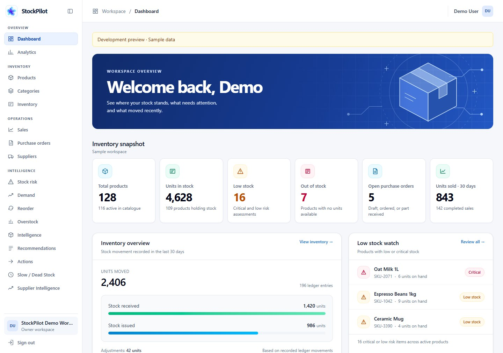

# StockPilot

StockPilot helps small and midsize businesses manage inventory, sales, and purchasing
in one workspace. It shows which products need attention, explains the evidence,
and recommends a next step. The owner decides what to do.

[Try the dashboard preview](#quick-start) · [Local setup](docs/getting-started.md) · [MIT License](LICENSE)



*Dashboard preview with sample data.*

## What works today

- **Dashboard and analytics:** See inventory balances, sales trends, and open purchase orders.
- **Inventory and sales:** Manage a product catalog and track adjustments and sales
  in an append-only stock ledger.
- **Suppliers and purchasing:** Draft purchase orders, mark them as placed, and
  record partial or full receipts.
- **Action Center:** Review recommendations and turn an approved replenishment
  action into a draft purchase order.
- **Workspace access:** Sign in to a workspace with owner and staff roles and
  business-scoped data. Accounts support email verification, password recovery,
  and optional authenticator codes with recovery codes.

| Intelligence engine | What it reports |
| --- | --- |
| Stock Risk | Items already out of stock or at risk of running out |
| Demand Planning | Rising, falling, or stable demand based on sales history |
| Reorder | Whether to replenish and a suggested quantity when the data supports one |
| Overstock | Items holding more stock than recent demand warrants |
| Slow / Dead Stock | Items selling slowly or holding stock with no recent sales |
| Supplier Intelligence | Observed lead times and delivery consistency |

Unified Intelligence combines the six engine results by product and shows the
evidence behind each assessment. It flags insufficient data instead of guessing.

## Quick start

Use Node.js 24 and npm. The dashboard preview needs only the frontend; it uses
sample data and requires no sign-in or database.

```bash
git clone https://github.com/jinx7-pixel/StockPilot.git
cd StockPilot
npm ci --prefix frontend
npm run dev --prefix frontend
```

Open [localhost:5173/app?preview=1](http://localhost:5173/app?preview=1).

### Run with a database

The full app uses PostgreSQL 18. Start with the
[local setup guide](docs/getting-started.md), then apply the migrations from the
`backend/` directory with `npm run migration:up`. Migrations create the tables
for workspaces, authentication, the stock ledger, sales, suppliers, purchase
orders, and the Action Center.

For the development database, set `PGPASSWORD` in `backend/.env` to the
password configured for PostgreSQL. The API uses a separate restricted role
configured in `backend/.env.runtime` when started with `npm run dev:local`.
See the [runtime role setup](docs/getting-started.md#5-run-the-backend)
and the [migration guide](database/README.md).

To test registration and password recovery, configure SMTP and `APP_PUBLIC_URL`
as described in the [local setup guide](docs/getting-started.md).

### Docker

Docker support is already in the repository:

| File | Purpose |
| --- | --- |
| [`docker-compose.yml`](docker-compose.yml) | PostgreSQL for development with the frontend and API running on the host |
| [`frontend/Dockerfile`](frontend/Dockerfile) | Builds the React frontend and serves it with Nginx |
| [`Dockerfile`](Dockerfile) | Builds the API and the separate migration job |
| [`docker-compose.prod.yml`](docker-compose.prod.yml) | Runs the frontend, API, PostgreSQL, and opt-in migration job for a local rehearsal |

See the [Docker rehearsal guide](docs/deployment.md#local-rehearsal) to start
the container stack on a fresh database and verify the health endpoints.

## Project layout

| Directory | Contents |
| --- | --- |
| [`frontend/`](frontend/) | React 19, TypeScript, Vite, and Tailwind CSS |
| [`backend/`](backend/) | Node.js, Express 5, TypeScript, and the inventory intelligence engines |
| [`database/`](database/) | Versioned PostgreSQL migrations managed with node-pg-migrate |
| [`docs/`](docs/) | Setup, [architecture](docs/architecture.md), and deployment |
| [`.github/workflows/`](.github/workflows/) | CI for lint, type checks, builds, tests, and migrations |

## Roadmap

Planned work includes multi-location inventory, barcode scanning, notifications,
demand forecasting, and deployment automation.

## License

StockPilot is licensed under the [MIT License](LICENSE).
